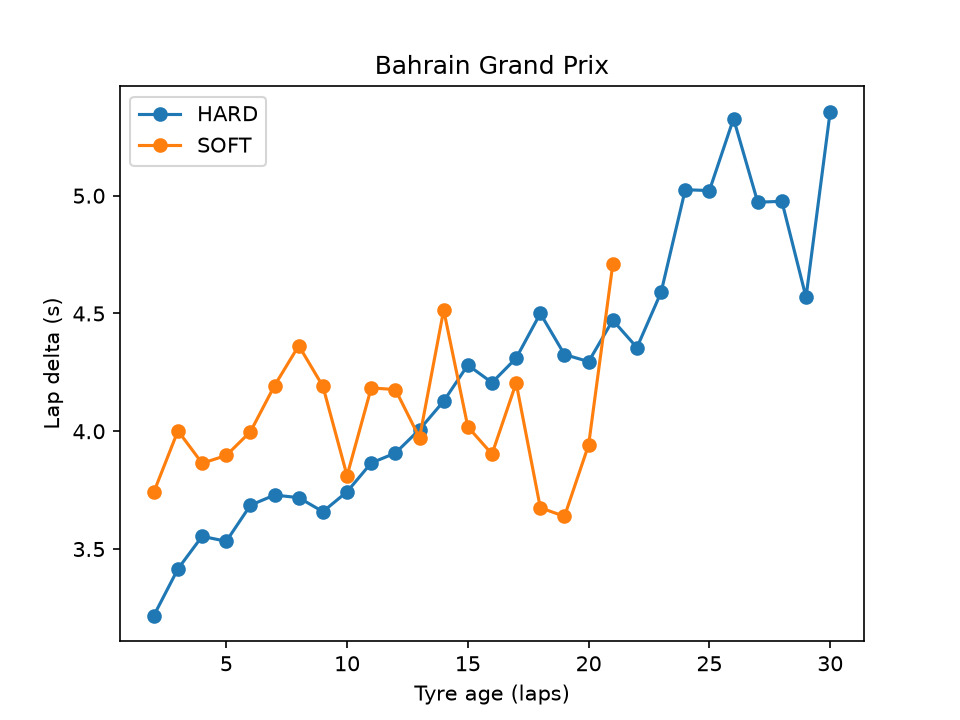
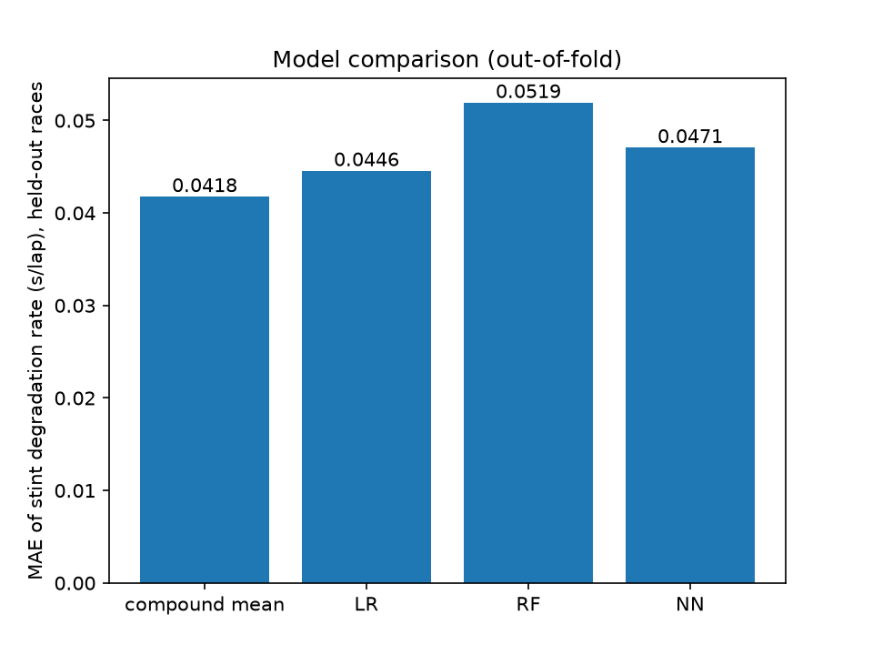
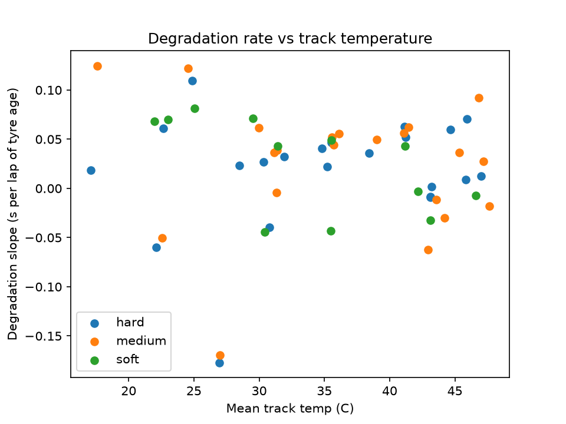
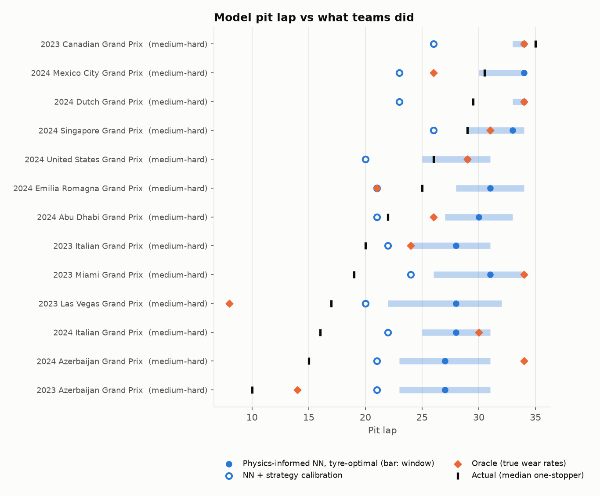
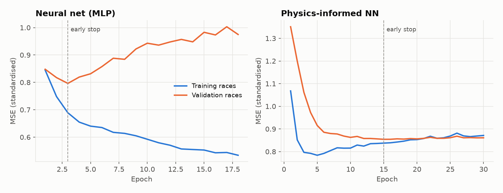

# F1 Tyre Degradation & Pit Strategy Simulator

Learns how Formula 1 tyres lose pace as they age, from every dry Grand Prix of 2023 and 2024, and
uses that to plan pit-stop strategies for races the model has never seen. It compares seven models,
from a one-line baseline to a physics-informed neural network written from scratch in numpy, and
checks the optimiser's pit laps against what teams actually did.

Course project, Intro to AI/ML. Python, numpy, pandas, scikit-learn, matplotlib, Streamlit.



## Run it

```bash
python -m venv .venv && source .venv/bin/activate
pip install -r requirements.txt

streamlit run app.py                                  # interactive app
python cli.py --list-races                            # terminal simulator
python cli.py --race "2024 Italian" --model degnet
python cli.py --race "2024 Dutch" --strategy M-H:28 --fast
python -m pytest -q                                   # correctness tests
python pipeline.py                                    # rebuild everything from scratch
```

The trained models, data and results are in the repo, so the app and CLI work straight away.
`pipeline.py` re-downloads (cached in `cache/`), retrains and redraws everything in about 30–40 minutes.

## What it does

1. **Data** (`f1sim/collect.py`, `f1sim/dataset.py`). 46 races from the [OpenF1](https://openf1.org)
   API. Wet races are detected automatically. Laps under safety car, VSC, red or yellow flags, pit
   in/out laps and outliers are removed. Fuel and track evolution are corrected, and every lap gets a
   target: the time lost to tyre wear since the start of its stint. Pit loss is measured per race.
2. **Models** (`f1sim/models.py`, `f1sim/nn.py`).

   | Model | Idea |
   |---|---|
   | Baseline | one wear rate per compound |
   | Linear / Ridge | wear rate as a linear function of conditions (L2 on condition effects only) |
   | Random forest, gradient boosting | tree ensembles on all features |
   | MLP | numpy neural network: backprop, Adam, L2, dropout, early stopping |
   | **Physics-informed NN** | numpy network that outputs the parameters of a wear curve (non-negative via softplus), residual on per-compound base rates, 5-network ensemble for uncertainty |

3. **Evaluation** (`f1sim/evaluate.py`, `f1sim/analysis.py`). Two protocols: *unseen circuits*
   (5-fold CV grouped by circuit) and *next season* (train 2023, test 2024). Every model's
   hyperparameters are tuned on validation circuits taken from the training data (nested
   validation). The evaluation reports bootstrap confidence intervals by race, curve-level accuracy,
   permutation importance, the temperature effect, learning curves and pit-lap error against an
   oracle.
4. **Strategy** (`f1sim/strategy.py`). Searches every legal 1-stop and 2-stop strategy, using each
   race's own lap-by-lap weather and measured pit loss. Stints are capped at the longest seen in the
   data, and the pit window covers every lap within 1 s of the optimum. `simulate()` returns the race
   lap by lap.
5. **Interfaces.**
   * `app.py`, a Streamlit app with four pages: strategy simulator, what-if weather, race explorer
     and model lab.
   * `cli.py`, a lap-by-lap terminal simulator.

## Results in brief

Full tables and discussion: **[results.md](results.md)**.

* **Random forest predicts degradation best** under both protocols. On unseen circuits it has a lap
  MAE of 0.568 s against 0.590 s for the baseline, and beats the baseline in 96% of bootstrap
  resamples. Its curve-level R² is 0.37 against 0.30.
* **The noise floor is close.** Even knowing each race's true wear rates gives 0.48 s. Most
  variation is driver-specific, so model differences are a few hundredths of a second.
* **Track temperature matters only slightly.** Wear rises about 25% from 18 °C to 49 °C, all else
  equal, and the variable contributes almost nothing to importance. Pirelli's compound choice per
  race already absorbs most of the effect.
* **Teams pit earlier than the tyre-optimal lap,** about 4 laps earlier even with the race's true
  wear rates, because of undercut pressure. With that tendency learned from training races, the
  neural networks predict the real pit lap to within about 5 laps. That beats both the half-distance
  rule (6.7) and the oracle (6.8).
* **More data would help.** The learning curve is still falling for gradient boosting and the neural
  network at 31 training races, but it has flattened for Ridge.

|                                       |                                  |
| ------------------------------------- | -------------------------------- |
|  |  |
|          |      |

## Project layout

```
f1sim/
  common.py     constants (fuel model, street circuits, exclusions)
  collect.py    OpenF1 download -> data/raw/
  dataset.py    cleaning, targets, track evolution, folds, pit truth
  features.py   feature sets and wear terms
  nn.py         numpy MLP, physics-informed DegNet, ensemble, gradient check
  models.py     all models + nested hyperparameter tuning
  evaluate.py   training under both protocols
  analysis.py   metrics, CIs, pit evaluation, importance, temperature, learning curve
  strategy.py   optimiser and simulate()
  plots.py      all figures
app.py  cli.py  pipeline.py  tests/  results.md
data/  models/  results/  plots/      generated
legacy/                               the first, 2024-only version of the project
```

## Limitations

* The optimiser plans one car on its own: no safety cars, traffic or rivals.
* The fuel effect is an assumption: 0.03 s per kg, 100 kg at the start.
* Only two seasons. 2022 needs an F1TV subscription, because F1's timing feed has required one
  since 2026.
* Pirelli's per-race compound allocation (C1–C5) is not in the data. It is the most promising
  feature to add.

See [results.md](results.md) for the details.
